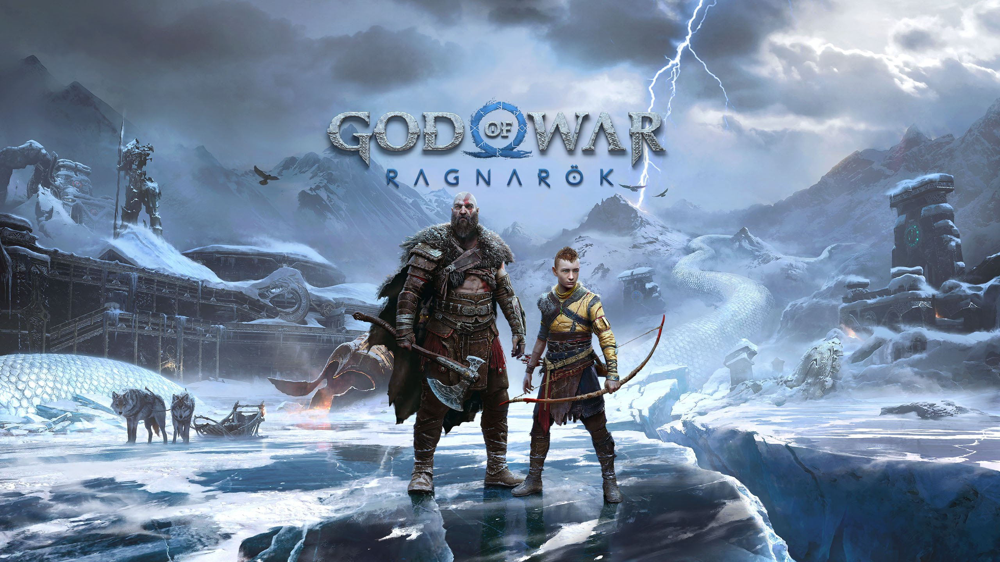
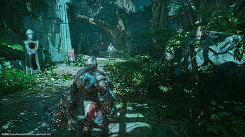

God of War Ragnarök continua a jornada de **Kratos e Atreus** pelo mundo nórdico e encerra uma fase importante da franquia. Esta análise pessoal, publicada originalmente em **26 de janeiro de 2025**, foi feita após **48 horas de jogo no PlayStation 4**. As seis categorias seguem o método *Seis ao Cubo*, com até 36 pontos por categoria.

## Gráficos — Perfeito (36/36)

- O PS4 ainda entrega cenários impressionantes, com riqueza de detalhes na água, na vegetação, nas embarcações e nos reinos nórdicos.
- A direção de arte proporciona diversos momentos de contemplação e exploração.

## História — Ótimo (30/36)
- A relação de Kratos e Atreus evolui em uma narrativa intensa, com grandes revelações e novos personagens.
- Algumas missões narrativas desaceleram demais o ritmo e o desfecho do Ragnarök parece apressado em comparação à expectativa criada.

## Jogabilidade — Perfeito (36/36)
- O combate expande a base de God of War (2018), com alternância fluida entre armas e habilidades.

- A progressão por equipamentos e melhorias ainda é mais complexa do que deveria, apesar da qualidade dos confrontos.

## Trilha sonora — Perfeito (36/36)
- A trilha de **Bear McCreary** combina coros e instrumentos de inspiração nórdica para intensificar batalhas e cenas emocionais.
- Um dos elementos mais consistentes de toda a jornada.

## Level design — Ótimo (30/36)
- Reinos com identidade própria, segredos e quebra-cabeças estimulam a exploração.
- Alguns trajetos exigem retornos repetidos e certas missões secundárias, especialmente em Vanaheim, poderiam ser mais objetivas.
- Há poucos NPCs para interagir além dos personagens relevantes à trama.

## Duração — Ótimo (30/36)
- As atividades opcionais complementam a história sem tornar a campanha excessivamente longa.
- Concluí a aventura em **48 horas**, priorizando o que achei interessante, sem perseguir a platina.

## Veredito — 198/216
- **Recomendo!** Ragnarök traz uma história envolvente, combates excelentes e um mundo rico em detalhes, apesar de algumas escolhas de ritmo e progressão.
- A nota original foi **198/216** (aproximadamente **9,2/10** em escala decimal).

*Esta página adapta a review publicada em 2025. Leia o artigo original no WordPress para a análise completa e todas as considerações pessoais.*
