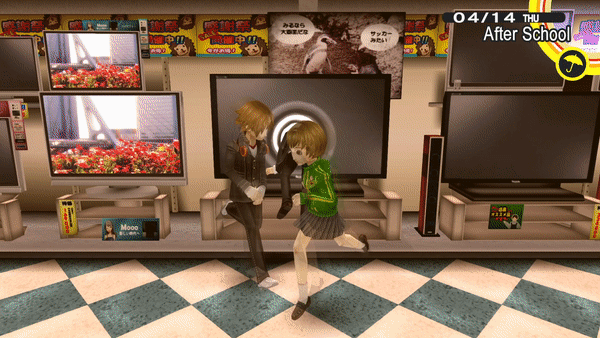
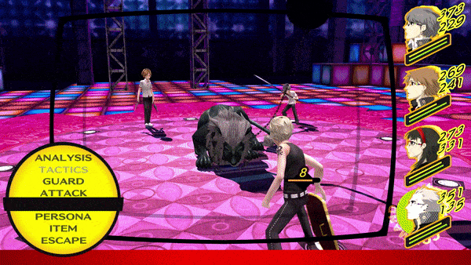
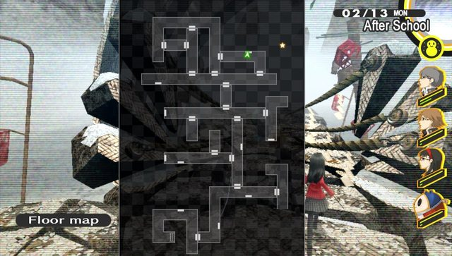

Após **86 horas em Inaba**, Persona 4 Golden se destaca pela maneira como transforma amizade, autoconhecimento e mistério em uma experiência pessoal. A análise foi publicada originalmente em **26 de abril de 2025**, depois de finalizar o jogo no PS Vita. As notas seguem meu método *Seis ao Cubo*, que avalia seis categorias com até 36 pontos cada.

## Gráficos — Perfeito (36/36)
- Modelos, expressões e texturas melhorados em relação à versão de PS2.
- Ambientes e personagens combinam com o estilo visual do jogo, mesmo nas limitações do PS Vita.
- Os sprites nos diálogos transmitem mais emoção do que algumas animações dos modelos 3D.

## História — Perfeito (36/36)
- A investigação de assassinatos em Inaba, o mundo dentro das televisões e as relações entre amigos mantêm o mistério envolvente.
- Personagens profundos, momentos de humor e cenas em estilo anime enriquecem a narrativa.
- A tradução brasileira da Phantasie Translate foi elogiada na análise original.

## Jogabilidade — Ótimo (30/36)
- O calendário exige equilibrar escola, estudos, Social Links, romances e exploração de masmorras.
- Combates por turnos, Personas e fusões oferecem boas possibilidades de estratégia.
- As masmorras podem ser repetitivas; os romances têm consequências mais limitadas do que o esperado.

## Trilha sonora — Perfeito (36/36)
- As composições de Shoji Meguro misturam rock, jazz, pop e elementos eletrônicos.
- Faixas originais e músicas adicionais da edição Golden ajudam a dar personalidade a cada momento da aventura.

## Level design — Ótimo (30/36)
- O mundo social de Inaba é denso em atividades e interações, mesmo com áreas pequenas.
- Masmorras procedurais oferecem desafios, embora a exploração possa se tornar repetitiva.

## Duração — Ótimo (30/36)
- A campanha combina dezenas de horas de história, vínculos sociais e conteúdo opcional.
- Minha conclusão levou **86 horas**, sem esgotar todas as possibilidades da aventura.

## Recomendo?

## Veredito — 8.9/10
- **Recomendo!** Persona 4 Golden é uma ótima porta de entrada para a série e uma jornada memorável sobre amizade, superação e mistério.
- A pontuação final apresentada no artigo original é **192/216 (8.9/10)**.

*Esta é uma adaptação da análise publicada no WordPress. Para ler os comentários e argumentos completos, use o link «Ler análise original completa».*
